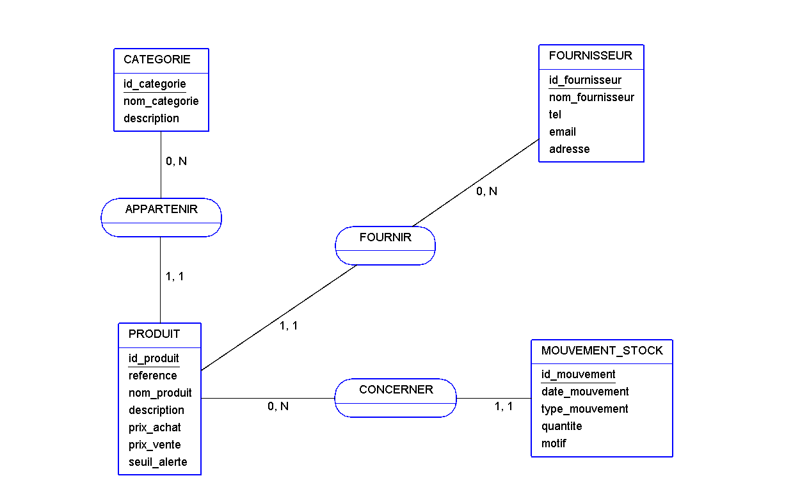

# Gestion de stock — Base de données MySQL

## 1. Présentation du projet

Ce projet consiste à concevoir et à implémenter une base de données relationnelle destinée à la gestion de stock d'un magasin spécialisé dans la vente de matériel informatique.

Il a été réalisé dans le cadre de mon apprentissage en première année, dans le but de mettre en pratique les notions fondamentales de conception et de manipulation des bases de données relationnelles.

Le projet s'appuie sur la méthode Merise pour la modélisation des données et sur SQL pour l'implémentation de la base de données.

## 2. Objectifs

L'objectif principal est de mettre en place une structure permettant de centraliser les informations relatives aux produits et de suivre les mouvements de stock.

Les objectifs spécifiques sont :

- Organiser les produits par catégories.
- Enregistrer les informations des fournisseurs.
- Gérer les informations descriptives et commerciales des produits.
- Enregistrer les entrées et les sorties de stock.
- Conserver l'historique des mouvements.
- Calculer la quantité disponible de chaque produit.
- Identifier les produits dont le stock atteint le seuil d'alerte.

## 3. Fonctionnalités

La base de données repose sur quatre tables principales :

| Table | Description |
|---|---|
| CATEGORIE | Gestion des catégories de produits |
| FOURNISSEUR | Enregistrement des fournisseurs |
| PRODUIT | Informations relatives aux produits |
| MOUVEMENT_STOCK | Historique des entrées et sorties |

Le stock disponible est calculé à partir des mouvements enregistrés :

**Stock disponible = Total des entrées − Total des sorties**

## 4. Modélisation

La conception de la base de données a été réalisée selon la méthode Merise.

Les principales étapes de modélisation sont :

- Analyse des besoins et définition des règles de gestion.
- Identification des entités et de leurs attributs.
- Réalisation du Modèle Conceptuel de Données (MCD).
- Transformation du MCD en Modèle Logique de Données (MLD).

Les diagrammes ont été réalisés avec le logiciel AnalyseSI.

### Modèle Conceptuel de Données (MCD)



### Modèle Logique de Données (MLD)


## 5. Technologies et outils utilisés

- **MySQL 8 :** système de gestion de base de données relationnelle.
- **SQL :** langage utilisé pour la création, la manipulation et l'interrogation des données.
- **MySQL Workbench :** environnement de rédaction et d'exécution des requêtes SQL.
- **AnalyseSI :** outil de modélisation de la base de données selon Merise.

## 6. Structure du projet

```text
Gestion-Stock/
│
├── Documentation/
│   └── Rapport_Gestion_Stock.pdf
│
├── Modelisation/
│   ├── gestion_stock.asi
│   ├── mcd_gestion_stock.png
│   └── mldgestion_stock.txt
│
├── gestion_stock.sql
├── README.md
└── .gitignore
```

## 7. Installation et exécution

### Prérequis

Pour utiliser ce projet, il est nécessaire de disposer de :

- MySQL Server 8.0 ou une version compatible.
- MySQL Workbench ou un autre client SQL compatible.

### Étapes d'exécution

1. Cloner ou télécharger ce dépôt GitHub.
2. Ouvrir MySQL Workbench.
3. Se connecter à un serveur MySQL.
4. Ouvrir le fichier `gestion_stock.sql`.
5. Exécuter le script SQL afin de créer la base de données, ses tables et d'insérer les données de démonstration.

**Remarque :** les requêtes doivent être exécutées dans l'ordre indiqué dans le fichier SQL.

## 8. Documentation

Le dossier `Documentation` contient le rapport de conception présentant l'analyse des besoins, les règles de gestion, les entités, les associations, le MCD et le MLD.

Le dossier `Modelisation` contient les fichiers et les représentations graphiques réalisés avec AnalyseSI.

## 9. Contexte pédagogique

Ce mini-projet a été réalisé lors de mon apprentissage en première année. Il m'a permis de découvrir et de mettre en pratique les différentes étapes de conception d'une base de données relationnelle, depuis l'analyse des besoins jusqu'à l'implémentation SQL.

Il constitue une première expérience pratique dans la modélisation et la gestion des données.

## 10. Auteur

Adoum Oumar Moussa Tahir — Étudiant en informatique — systèmes intelligents et recherche opérationnelle.

GitHub : `https://github.com/AdoumOMT`